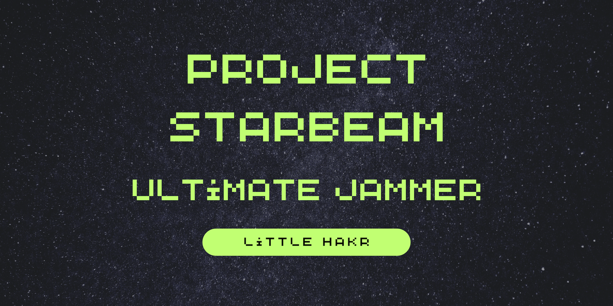
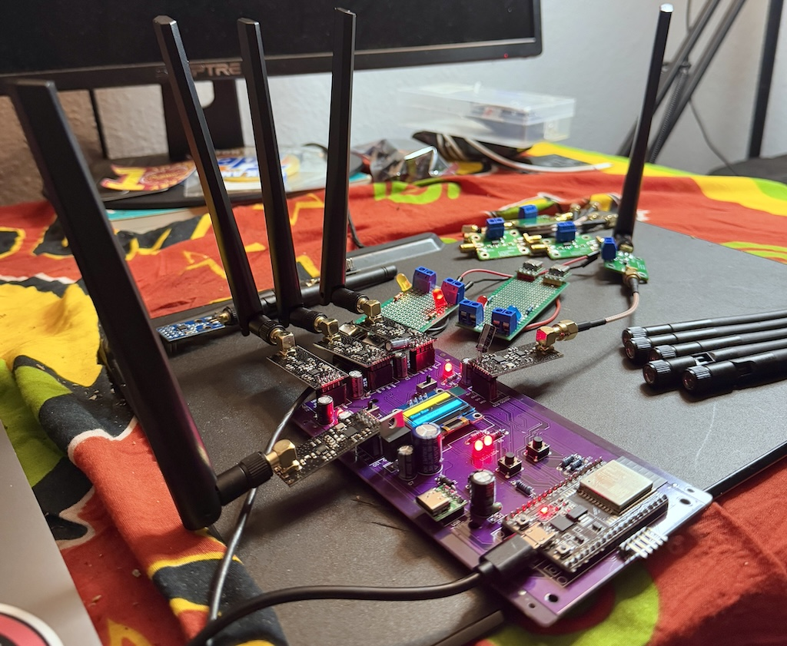
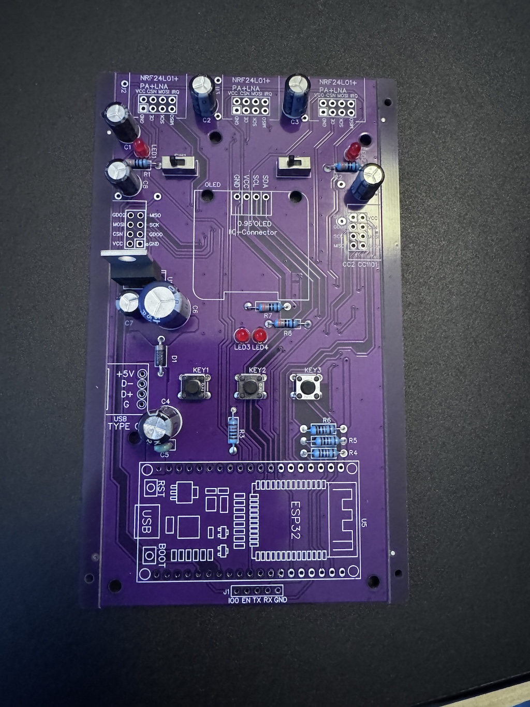
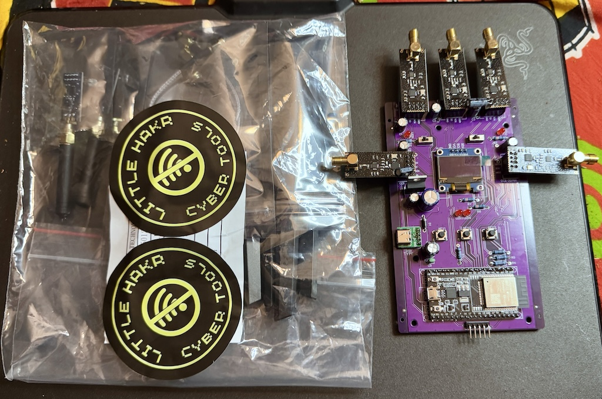
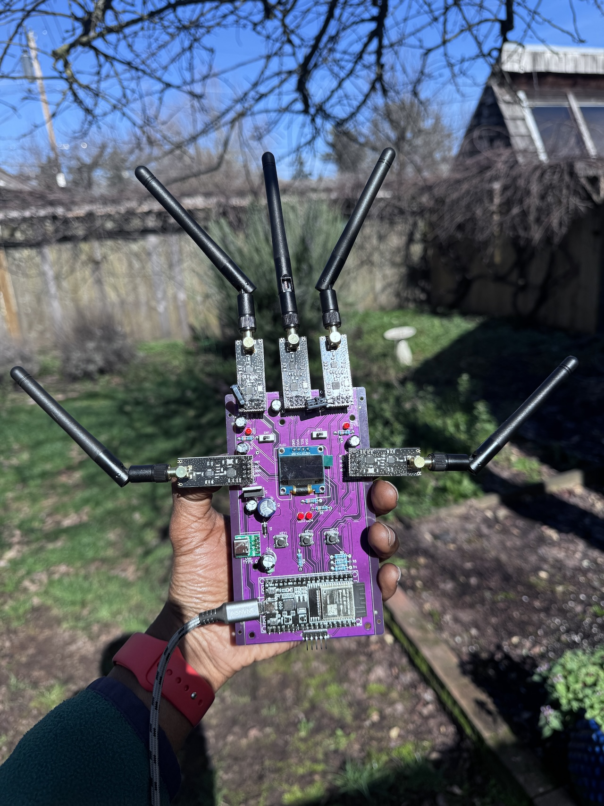
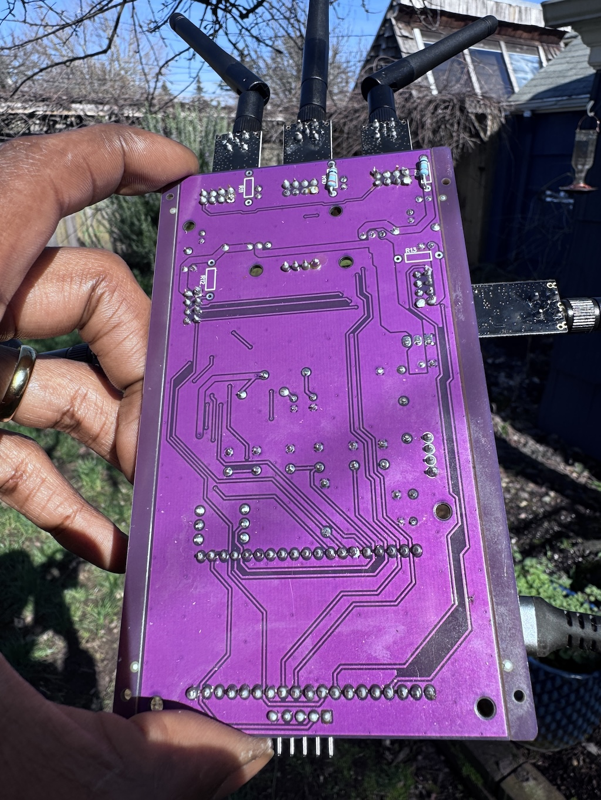
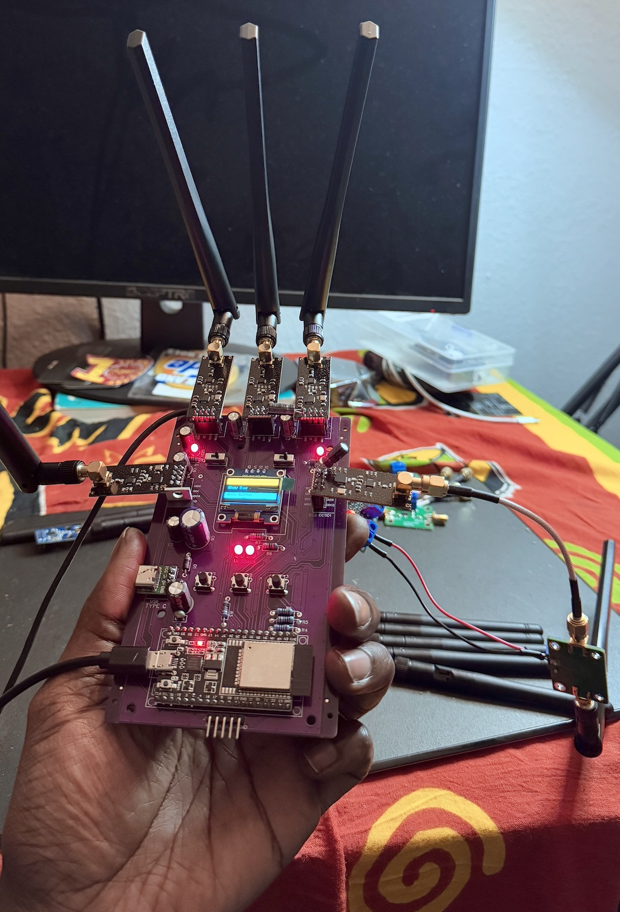
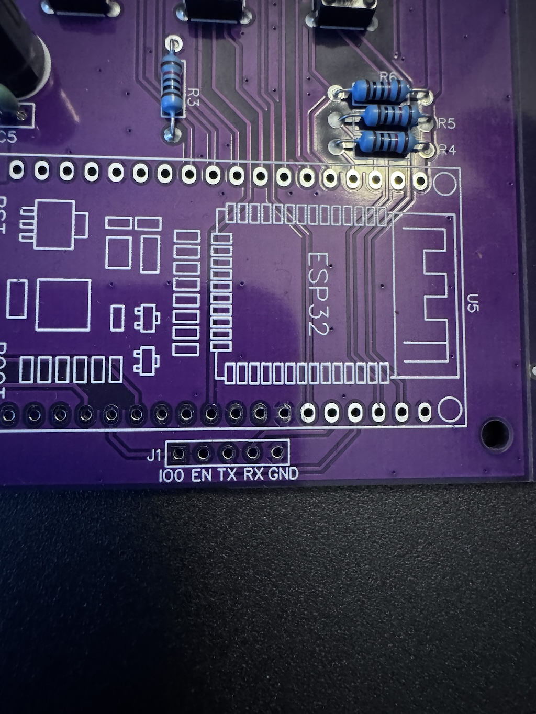
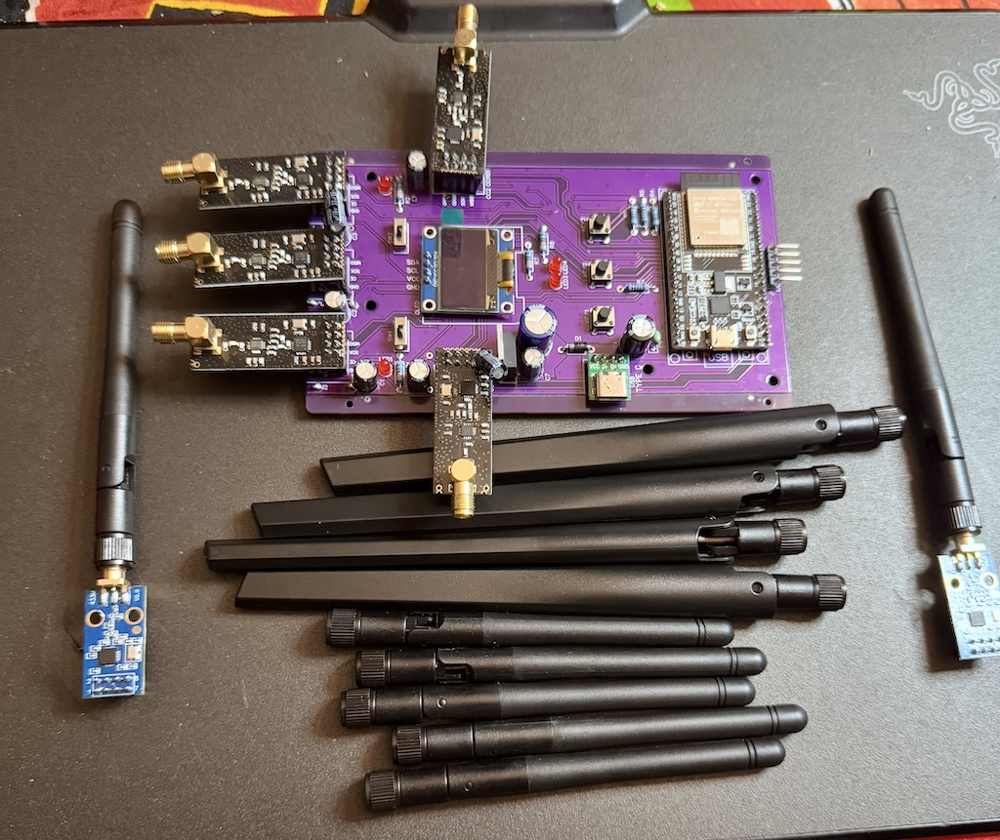

# project starbeam v2 2026
**The Ultimate ESP32 WiFi + BT + Drone Jammer w/ 5 Radios.**

[](LICENSE)
[](https://www.espressif.com/en/products/socs/esp32)
[]()

 

> **⚠️ LEGAL DISCLAIMER**: This tool is designed for **AUTHORIZED SECURITY TESTING ONLY**. Unauthorized use of RF jamming, WiFi deauthentication, or network analysis tools may violate federal, state, and local laws including but not limited to the Computer Fraud and Abuse Act (CFAA), FCC regulations, and similar laws in other countries. Users are solely responsible for compliance with all applicable laws and regulations. By using this software, you agree to use it only on networks and systems you own or have explicit written authorization to test.

## Project Starbeam: An Affordable Approach to Signal Intelligence for Security Applications

Project Starbeam is an innovative signal intelligence platform leveraging cost-effective, open-source hardware to deliver advanced capabilities in signal analysis, generation, and manipulation. Central to its design is a custom PCB incorporating the ESP32-WROOM-32D microcontroller alongside multiple radio frequency modules. The system's modularity and compatibility with devices like HackRF One extend its frequency coverage up to 6 GHz, making it a versatile tool for various applications in security testing and operations.

**Intended Use Cases:**
- Authorized penetration testing on owned networks
- Educational research in controlled environments
- RF security auditing with written authorization
- Capture-the-Flag (CTF) competitions
- Wireless protocol analysis and research

 

## Starbeam PCB Assembly Guide
This guide provides instructions for completing the Starbeam PCB assembly after the components have been manufactured and attached. You can source the necessary parts from various suppliers, but the provided links offer decent price points. It is crucial to obtain the exact specified parts if using this PCB, especially for the display and USB-C module.

This is what you will get after PCB order:
 

### PCB-A Notes:
**This is a 4-layer PCB, there are notes for the required specifications in /hardware**
**This is an advanced project, so please do not waste your time & money if you do not understand PCB ordering, & if you need any assistance you can book a call & i'll be more than happy to walk you through the whole build process:
https://linktr.ee/littlehakr

Link to PCB to place order:
https://pcbway.com/g/87Pi52

**Required Components After PCB Assembly:**
- **ESP32-Wroom-32D**:
    - https://amzn.to/3YR1noR
- **SSD1306 128x64 0.96-inch Display**:
    - https://amzn.to/4lONdP9
- **NRF24 Radios (x5) for 2.4GHz**:
    - https://amzn.to/4iBofjl
- **CC1101 Radios (x2) for 433MHz**:
    - https://amzn.to/4iuopZH
- **USB-C Module**:
    - https://amzn.to/4lKZ5BL

**Software Setup & Code Upload:**
1. Download Arduino IDE:
    - Get it here: https://www.arduino.cc/en/software/
2. Install Arduino IDE:
    - Refer to the installation guide:
    - https://docs.arduino.cc/software/ide-v2/tutorials/getting-started/ide-v2-downloading-and-installing/
3. Open the Code:
    - Extract the starbeam code .zip file.
    - **Extract SmartRC-CC1101-Driver-Lib2 2.zip & add it to your Documents/Arduino/libraries/ folder. This must be added to use the 2nd CC1101 radio module!**
    - If you are creative, you can also add up to 5 CC1101's for advanced testing.
    - Open the starbeam_v2.ino file in starbeam_v2/ folder. This will automatically open the code in Arduino IDE.
4. Upload Code to ESP32:
    - Upload the code to your ESP32 microcontroller using Arduino IDE.
    -   Note: Videos on uploading code and using Arduino IDE are available in the Hakr Hardware Club (https://whop.com/little-hakr).
5. Final Steps:
    - Attach the antennas that correspond to your desired setup.
    - Good luck...

 
 
 
 

## Hardware Specifications

### Core Components

- **Microcontroller**: ESP32-WROOM-32D (240 MHz dual-core, 4MB flash, 520KB SRAM)
- **Display**: SSD1306 OLED (128×64, I²C)
- **Radio Modules**:
  - Up to 5× NRF24L01+ (2.4 GHz) with PA+LNA
  - Up to 2× CC1101 (300-928 MHz, dual-chip configuration)
  - Optional HackRF One integration (1 MHz - 6 GHz)
- **Controls**: 3-button interface (Up, Down, Select)

### Pin Configuration

| Component | Pin(s) | Interface |
|-----------|--------|-----------|
| SSD1306 OLED | SDA/SCL (default I²C) | I²C @ 0x3C |
| NRF24 (VSPI) | CE=27/26/25, CS=15/33/5 | VSPI |
| NRF24 (HSPI) | CE=4/32, CS=2/17 | HSPI |
| CC1101 #1 | SS=2, GDO0=4, GDO2=16 | Shared SPI |
| CC1101 #2 | SS=32, GDO0=35, GDO2=17 | Shared SPI |
| Buttons | UP=39, DOWN=34, SEL=36 | GPIO |

## System Architecture

**ESP32-WROOM-32D Microcontroller**

At the core of Project Starbeam is the ESP32-WROOM-32D, a powerful Wi-Fi and Bluetooth combination module designed for a wide range of applications. Key features include:
* Dual-core 32-bit processor with adjustable clock frequency (80 MHz to 240 MHz)
* 4 MB of embedded flash memory
* Integrated 2.4 GHz Wi-Fi and Bluetooth capabilities
* Multiple GPIOs for peripheral interfacing

These specifications make the ESP32-WROOM-32D suitable for handling complex signal processing tasks efficiently.

**Radio Frequency Modules**

The platform's design allows for configurable RF modules, enhancing its versatility:
**Left Switch - Top 3 radios**
**Right Switch - 2 Side radios**

* **Configuration A**: Five NRF24L01+PA+LNA modules
* **Configuration B**: Three NRF24L01+PA+LNA modules combined with two CC1101 modules
* **Configuration C?**: Five CC1101 modules

This modularity enables tailored configurations to meet specific operational requirements, facilitating tasks such as frequency scanning and signal generation.

**HackRF One Integration**

To extend the system's frequency range, Project Starbeam integrates with HackRF One, an open-source software-defined radio (SDR) peripheral capable of transmitting and receiving signals from 1 MHz to 6 GHz. It connects to a raspberry pi via the TX/RX pins at the bottom. This integration significantly broadens the platform's capabilities, allowing for comprehensive signal analysis across a wide spectrum.



## Features

### Core Capabilities

#### 🔊 RF Jamming (Authorized Use Only)
- **Bluetooth Jammer**: Disrupts 2.4 GHz Bluetooth connections
- **WiFi Jammer**: Interferes with 2.4 GHz WiFi networks
- **Drone Jammer**: Targets common drone control frequencies
- **CC1101 Jammer**: Broadband noise on 433 MHz ISM band

#### 📡 RF Analysis
- **NRF24 Spectrum Scanner**: Real-time 2.4 GHz band visualization
- **CC1101 Frequency Scanner**: 300-928 MHz signal detection
- **RSSI Monitoring**: Signal strength analysis across bands
- **Signal Recording**: Capture raw RF data for later analysis
- **Signal Playback**: Replay captured RF signals

#### 📶 WiFi & Bluetooth Scanning
- **WiFi Network Scanner**: Enumerate access points with RSSI, channel, security
- **WiFi Channel Heatmap**: Visualize 2.4 GHz channel utilization
- **BLE Device Scanner**: Discover Bluetooth Low Energy devices
- **Independent Web Server**: Remote access with captive portal

### 🔐 Security Testing Features (V2)

> **CRITICAL**: These features require explicit authorization. See Legal Compliance section below.

#### WiFi Security Testing

**1. Deauthentication Attacks**
- **Targeted Deauth**: Disconnect specific clients from an access point
  - Select target network from scan results
  - Promiscuous mode sniffing to identify connected clients
  - Sends burst of 16 deauth frames per detected station
  - Real-time status display (frames sent, clients eliminated)
- **Broadcast Deauth**: Disrupt all nearby WiFi networks
  - Channel hopping (1-13) for maximum coverage
  - Affects all detected station↔AP associations
  - Extra confirmation required due to broad impact

**2. Beacon Flooding**
- Generate up to 20 fake access points with random BSSIDs
- Configurable SSID list or random generation
- Full IEEE 802.11 beacon frame construction
- Transmission rate: >100 beacons/second
- Purpose: Test AP isolation, scanner resilience, network discovery

**3. Probe Request Flooding**
- Simulate multiple client devices searching for networks
- Random MAC address generation (locally administered)
- Wildcard (all APs) or targeted SSID modes
- Transmission rate: >500 probes/second
- Purpose: Test AP response handling, detection evasion research

**4. PMKID Capture**
- Extract PMKID from WPA2/WPA3 EAPOL handshakes
- Promiscuous mode capture of EAPOL Message 1 (M1)
- RSN Information Element parsing
- Hashcat-compatible output format for educational analysis
- 2-minute timeout with automatic WPA2/3 filtering
- Purpose: Research WPA security, offline analysis studies

### 🌐 Web Interface

**Features:**
- **WiFi Scanner Dashboard**: Live network list with refresh
- **BLE Scanner Dashboard**: Discovered BLE devices
- **Security Testing Dashboard**: Attack control interface with legal warnings
- **Background Scanning**: Independent WiFi/BLE scan toggles
- **JSON APIs**: `/api/wifi`, `/api/ble`, `/api/attack/status`
- **Captive Portal**: Automatic redirect on connection

**Access:**
1. Select "Web Server" from menu
2. Connect to `StarbeamAP` WiFi (password: `starbeam2024`)
3. Navigate to `http://192.168.4.1`
4. Access security features at `http://192.168.4.1/security`

## Performance Metrics

### Firmware Statistics

| Metric | Starbeam V1 | Starbeam V2 | Improvement |
|--------|-------------|-------------|-------------|
| Flash Usage | ~1.79 MB (57%) | 1.81 MB (58%) | +20 KB (security features) |
| RAM Usage | ~69.6 KB (21%) | 69.9 KB (21%) | +0.9 KB (static buffers) |
| Boot Time | ~2.5s | ~2.5s | No change |
| WiFi Scan | ~3s | ~3s | No change |
| BLE Scan | ~10s | ~10s | No change |

### Security Feature Performance

| Feature | Target | Status |
|---------|--------|--------|
| Beacon Flood | >100/sec | ✓ Implemented |
| Probe Flood | >500/sec | ✓ Implemented |
| Deauth (Targeted) | Real-time | ✓ Working |
| Deauth (Broadcast) | Real-time | ✓ Working |
| PMKID Parse Time | <100ms | ✓ Optimized |

### Memory Optimization

- **Static Buffer Strategy**: All attack frames use pre-allocated buffers (no heap)
- **Total Overhead**: <1 KB static RAM for security features
- **Zero Fragmentation**: No dynamic allocation in attack loops
- **Watchdog Safety**: `yield()` calls every 10 frames prevent WDT timeout

## Installation & Setup

### Prerequisites

- **Arduino IDE 2.x** or **Arduino CLI**
- **ESP32 Board Support**: `https://dl.espressif.com/dl/package_esp32_index.json`
- **Required Libraries** (install via Library Manager):
  - Adafruit GFX Library
  - Adafruit SSD1306
  - U8g2_for_Adafruit_GFX
  - RF24 by TMRh20
  - ELECHOUSE_CC1101_SRC_DRV by LSatan
  - ESP32 BLE Arduino (included with board support)

### Manual Library Installation

Extract `SmartRC-CC1101-Driver-Lib2 2.zip` to `~/Documents/Arduino/libraries/` for dual CC1101 support.

### Compilation & Upload

```bash
# Using Arduino CLI (Recommended)
arduino-cli compile --fqbn esp32:esp32:esp32:PartitionScheme=huge_app starbeam_v2/
arduino-cli upload --fqbn esp32:esp32:esp32:PartitionScheme=huge_app -p /dev/cu.SLAB_USBtoUART starbeam_v2/

# Monitor serial output
screen /dev/cu.SLAB_USBtoUART 115200

# Port examples:
# macOS:   /dev/cu.SLAB_USBtoUART or /dev/cu.usbserial-*
# Linux:   /dev/ttyUSB0 or /dev/ttyACM0
# Windows: COM3 or COM4 (check Device Manager)
```

**Board Configuration:**
- Board: ESP32 Dev Module
- Upload Speed: 921600
- CPU Frequency: 240 MHz
- Flash Size: 4MB (32Mb)
- Partition Scheme: **Huge APP (3MB No OTA/1MB SPIFFS)** - REQUIRED for V2 security features

## Usage Guide

### Basic Operation

1. **Power on**: ESP32 displays "CYPHER BOX" splash screen
2. **Navigate menu**: Use UP/DOWN buttons to scroll, SELECT to choose
3. **Select function**: Choose from jamming, scanning, or security testing
4. **Stop operation**: Long-press SELECT (1 second) to exit most modes

### Security Testing Workflow

#### Targeted Deauth Attack Example

```
1. Navigate to "Deauth Target" menu item
2. Press SELECT → Legal warning appears
3. Press SELECT to acknowledge
4. Device scans for networks (5-10 seconds)
5. Use UP/DOWN to select target network YOU OWN
6. Press SELECT to start attack
7. Display shows: frames sent, clients eliminated
8. Long-press SELECT (1 sec) to stop
```

#### Beacon Flooding Example

```
1. Navigate to "Beacon Flood" menu item
2. Press SELECT → Legal warning appears
3. Press SELECT to acknowledge
4. Attack starts with 20 fake APs
5. Display shows: beacons sent, channel info
6. Long-press SELECT (1 sec) to stop
```

#### PMKID Capture Example

```
1. Navigate to "PMKID Capture" menu item
2. Press SELECT → Legal warning appears
3. Press SELECT to acknowledge
4. Device scans for WPA2/WPA3 networks only
5. Select target network YOU OWN
6. Press SELECT to start listening
7. Wait for EAPOL handshake (up to 2 minutes)
8. If captured: Check serial monitor for hashcat format
9. Press SELECT to exit
```

#### Web Interface Control

```
1. Navigate to "Web Server" and press SELECT
2. Connect phone/laptop to "StarbeamAP" WiFi
3. Browser should auto-redirect to 192.168.4.1
4. Click "Security" link in navigation
5. Read and acknowledge legal warning
6. Select network index from WiFi table
7. Click "Start Targeted Deauth" (or other attack)
8. Monitor status on web page
9. Click "STOP ATTACK" button when done
```

### Serial Monitor Output

Enable verbose logging (115200 baud) to see:
- Boot sequence and hardware initialization
- Network scan results with MAC addresses
- Attack status (frame counts, captures)
- PMKID data in hashcat format
- Error messages and debug info

## Legal Compliance

### Authorization Requirements

You **MUST** have explicit written authorization before using security testing features on:
- Any network you do not own
- Any device you do not own
- Any frequency you are not licensed to transmit on

### Applicable Laws

**United States:**
- Computer Fraud and Abuse Act (CFAA) - 18 U.S.C. § 1030
- FCC Part 15 regulations (unlicensed RF transmission)
- State computer crime statutes

**United Kingdom:**
- Computer Misuse Act 1990
- Wireless Telegraphy Act 2006

**European Union:**
- General Data Protection Regulation (GDPR)
- National computer crime laws

**Other Countries:**
- Check local laws before use
- RF transmission regulations vary by country
- Some features may be prohibited entirely

### Recommended Use Cases

✅ **Authorized**:
- Testing your own home/office network
- Penetration testing with signed contract
- Academic research in controlled lab environment
- CTF competitions (explicit rules permitting)
- Security audits with client authorization

❌ **Unauthorized**:
- Public WiFi networks (coffee shops, airports, etc.)
- Neighbor's WiFi network
- Any network without explicit permission
- "Testing" corporate networks without authorization
- Any malicious or illegal activity

### Disclaimer

The developers of Project Starbeam assume **NO LIABILITY** for misuse of this tool. By using this software, you agree:
- You are solely responsible for legal compliance
- You will only use features on authorized systems
- You understand the legal risks and consequences
- You will not hold developers liable for your actions

## Applications

* **Tactical Operations**: Project Starbeam serves as a valuable tool in secure communications testing, unauthorized transmission detection, counter-surveillance, and communications security assessments for tactical teams.
* **Border Security**: The platform aids in detecting unauthorized communication devices, analyzing suspicious signal activities, identifying signal-based threats, and monitoring restricted frequencies in sensitive areas.
* **Critical Infrastructure Protection**: It facilitates vulnerability assessments of wireless systems, detection of potential signal-based attacks, security testing of IoT deployments, and identification of rogue devices on secure networks.
* **Training and Simulation**: As a cost-effective platform, Project Starbeam supports signal intelligence training, simulation of various RF threat scenarios, hands-on training for technical personnel, and development of countermeasures against signal-based threats.
* **Forensic Investigations**: The system assists in analyzing RF evidence, signal pattern matching for forensic purposes, documentation of unauthorized transmissions, and reconstruction of communications timelines.

## Technical Specifications

* **Microcontroller:** ESP32-WROOM-32D
* **RF Modules:**
    * Configuration A: 5x NRF24L01+PA+LNA
    * Configuration B: 3x NRF24L01+PA+LNA and 2x CC1101
* **Extended Frequency Range:** Up to 6 GHz (with HackRF One)
* **Power Specifications:** micro-USB & USB-C for 5V
* **Connectivity:** Wi-Fi, Bluetooth, Serial

## Architecture & Technical Details

### WiFi Attack Framework

**Core Components:**
- `src/wifi_attack.h` - Attack type definitions, IEEE 802.11 frame structures
- `src/wifi_attack.cpp` - Raw frame injection, promiscuous mode sniffing
- `esp_wifi_80211_tx()` - Low-level ESP32 API for frame transmission
- `esp_wifi_set_promiscuous()` - Monitor mode for packet capture

**Frame Construction:**
- Deauth frames: Type 0xC0, configurable reason codes (1, 3, 7)
- Beacon frames: Type 0x80, complete IE construction (SSID, Rates, DS Param)
- Probe frames: Type 0x40, random MAC generation with proper bit flags
- EAPOL parsing: RSN IE navigation for PMKID extraction

**Memory Management:**
- Static buffers: 128 bytes (beacon), 64 bytes (probe)
- No heap allocation in attack loops
- IRAM_ATTR callbacks for interrupt safety

### Web Server Architecture

**Enhanced Features (V2):**
- Independent lifecycle from WiFi scanner
- Background scanning with toggle controls
- Security dashboard with legal warnings
- RESTful JSON APIs for remote monitoring
- Captive portal for automatic redirection

**Endpoints:**
- `/` - Home dashboard
- `/wifi` - WiFi scanner page
- `/ble` - BLE scanner page
- `/security` - Security testing dashboard (NEW)
- `/api/wifi` - WiFi scan results JSON
- `/api/ble` - BLE scan results JSON
- `/api/attack/status` - Attack status JSON (NEW)

## Future Expansion

The platform's open architecture allows for numerous potential expansions, including integration with additional sensor types, implementation of machine learning for signal classification, development of specialized modules for particular frequency bands, creation of distributed sensor networks, addition of advanced encryption capabilities, integration with existing security infrastructure, and development of custom analysis software for specific needs.

 

## Contributing

Contributions are welcome! Please:
1. Fork the repository
2. Create a feature branch
3. Add tests for new features
4. Update documentation
5. Submit a pull request

**Code of Conduct**: This project is for educational and authorized security research only. Contributions that facilitate illegal activity will be rejected.

## License

Apache License 2.0 - See [LICENSE](LICENSE) file for details.

## Acknowledgments

- ESP32-Deauther project (tesa-klebeband) for WiFi attack research
- Adafruit for display libraries
- TMRh20 for NRF24 library
- LSatan for CC1101 driver
- Security research community

## Support & Documentation

- **GitHub Issues**: Report bugs or request features
- **Serial Monitor**: Enable at 115200 baud for verbose debugging
- **Hardware Schematics**: `hardware/starbeam_V1_design/`
- **CLAUDE.md**: Development guide for contributors

## Projekt StarBeam 2.0
**Version 2 is being manufactured... 10 NRFs, 2 ESP32's & a BW16.**
- **cypher**
- **little hakr**
